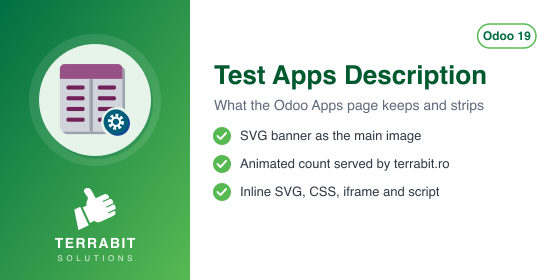

====================================
Test Apps Description: documentation
====================================

This page comes from ``doc/index.rst``. It checks how the **Documentation** tab of Odoo Apps
renders reStructuredText.

Headings and text
=================

Inline styles: **bold**, *italic*, ``literal``, and a link to
`terrabit.ro <https://www.terrabit.ro>`_.

Subheading
----------

1. A numbered list
2. with two items

* A bullet list

  * with a nested item

Note and warning
================

.. note::

   An admonition of type *note*.

.. warning::

   An admonition of type *warning*.

Code
====

.. code-block:: python

   env["ir.config_parameter"].sudo().get_param("theme_terrabit.apps_count_total")

Table
=====

========  ============================  =========
Case      Technique                     On Apps
========  ============================  =========
1         SVG from terrabit.ro          kept
5         Inline SVG with SMIL          stripped
7         iframe                        stripped
========  ============================  =========

Images
======

An image from the module (relative path):

An external image served by terrabit.ro (animated count):

.. image:: https://www.terrabit.ro/theme_terrabit/apps-count.svg
   :alt: 800+
